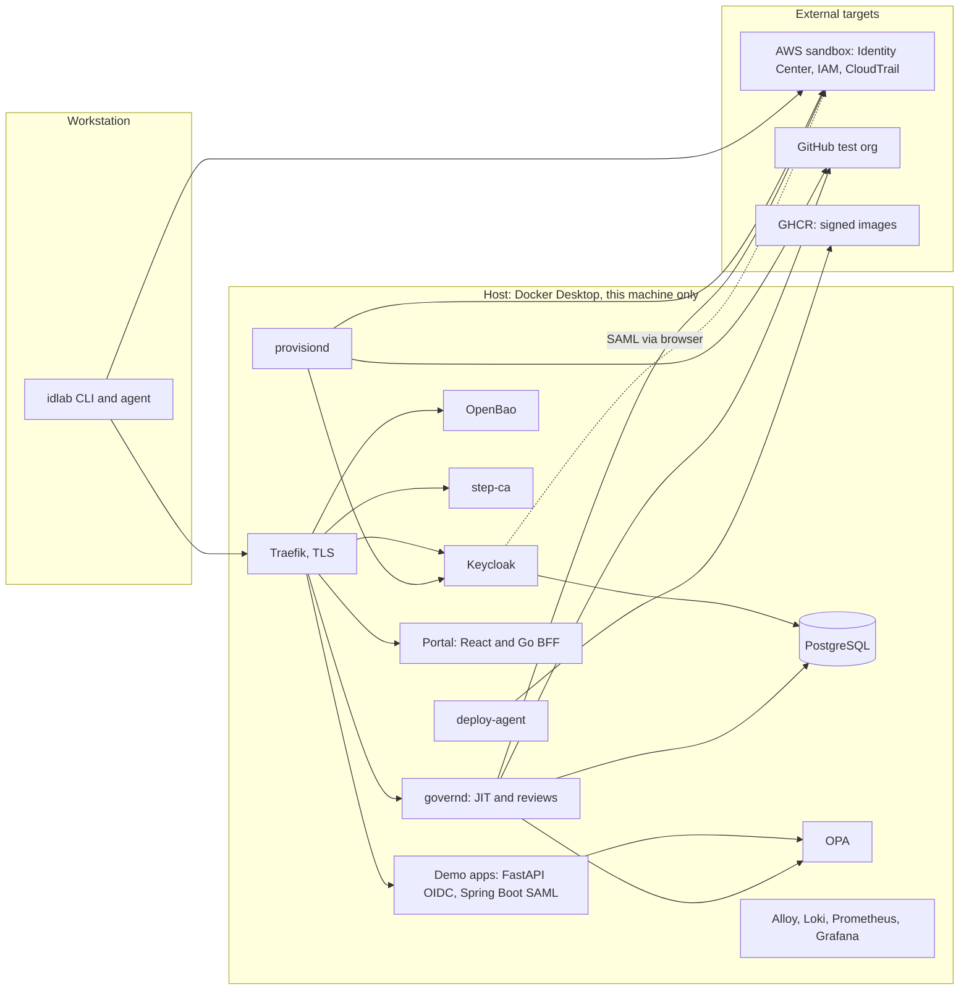

# identity-lab plan

identity-lab is a self-hosted identity and access platform built from modules. Each
module is a GitHub milestone with its own plan file in [docs/plan/](plan/), its own
ADRs, tests and measured results, so modules can be built one at a time or in parallel.
Known constraints and how the plan handles them are in [RISKS.md](RISKS.md).

## Ground rules

- **Hosting**: one Windows 11 machine with Docker Desktop (WSL2). Nothing is hosted in a
  cloud.
- **Exposure**: this machine only. Only the reverse proxy publishes ports, bound to
  127.0.0.1; nothing is reachable from the LAN or the internet.
- **AWS is a target, not a host**: the AWS modules manage access to a dedicated AWS
  Organization used only for the lab, with free services only (Organizations, IAM
  Identity Center, IAM, STS, CloudTrail event history), an SCP that allows only those
  services, and a budget alarm at USD 1.
- **GitHub is a target too**: provisioning and audit rules run against a free test
  organization.
- **Pull-based delivery**: CI runs on GitHub-hosted runners and signs every image; the
  host pulls and verifies. No runner on the host, no inbound path from GitHub.
- **Fail closed**: the host is not always on, so anything time-bound must also end on
  the target side; when the host starts, overdue grants are removed before anything
  else runs.
- **No credential outlives its grant**: SSH certificates, OpenBao tokens and AWS
  sessions issued under a grant expire no later than the grant.
- **One writer per object**: each kind of identity data has exactly one writer (see
  Ownership); nothing is changed by hand in an admin console.
- **Pull requests only**: every change goes through a pull request with all checks green.
- **Decisions in writing**: every significant decision gets an ADR in `docs/adr/`.
- **Evidence**: no number goes in the README unless a test or a script produced it.

## Architecture



Lab hostnames live under a private `.internal` domain, with certificates from the lab
CA. Grafana Alloy collects logs and metrics from every container (edges omitted).

## Components

| Component | Technology | Modules |
|---|---|---|
| `idlab` CLI, TUI and background agent | Go, Bubble Tea, AWS SDK for Go v2 | M01, M02, M03, M08 |
| Lab CA | Name-constrained root and intermediate; step-ca from M02 | P1, M02 |
| Reverse proxy | Traefik (file provider) | P1 |
| Identity provider | Keycloak 26.8 or later, PostgreSQL | M04, M06 |
| IdP and AWS configuration | Terraform (keycloak/keycloak and AWS providers) | M04 to M07, M12 |
| Demo apps | FastAPI (OIDC), Spring Boot (SAML) | M05, M06, M11 |
| `provisiond` | Go, SCIM 2.0 client and server | M07 |
| `governd` | Go, PostgreSQL | M08, M09 |
| Policy engine | OPA (Rego), signed bundles | M11 |
| `idaudit` | Go CLI | M10 |
| Secrets broker | OpenBao | M03 |
| SSH CA | step-ca | M02 |
| Monitoring | Grafana Alloy, Loki, Prometheus, Grafana | P1, M13 |
| Portal | React + TypeScript, Go backend-for-frontend | M14 |
| `deploy-agent` | Go, sigstore verification | P2 |

## Ownership

| Data | Only writer |
|---|---|
| Realms, clients, flows, roles, role mappings, definitions of privileged groups | Terraform |
| Users and their department and team group memberships | HR source, through the Keycloak SCIM API |
| Privileged group memberships, AWS JIT assignments, privileged GitHub teams | governd (M08) |
| Users and non-privileged groups in downstream systems (apps, AWS, GitHub) | provisiond (M07) |

Privileged access never flows through synced groups. A nightly Terraform plan and the
provisiond drift report catch any other change.

## Code layout

```
cmd/          Go binaries: idlab, idaudit, governd, provisiond, portal-bff, deploy-agent
internal/     shared Go packages: connectors, auth, store, audit log
apps/         demo-oidc-fastapi, demo-saml-spring, portal-web
infra/        compose (one file per module), terraform, traefik, observability, ca
policies/     Rego policies and tests
detections/   detection rules and test fixtures
docs/         plan, adr, threat-model, runbooks, results
```

All Go code is one Go module, and the repository has one version line.

## Modules

| ID | Module | Track | Size | Depends on | Plan |
|---|---|---|---|---|---|
| P0 | Foundation | all | M | - | [P0](plan/P0-foundation.md) |
| P1 | Platform runtime | B | L | P0 | [P1](plan/P1-runtime.md) |
| P2 | Secure delivery | D | L | P1 | [P2](plan/P2-secure-delivery.md) |
| M01 | AWS access manager | A | L | P0 | [M01](plan/M01-aws-access-manager.md) |
| M02 | SSH certificate authority | A | M | M04 | [M02](plan/M02-ssh-ca.md) |
| M03 | Secrets broker | A | M | M04 | [M03](plan/M03-secrets-broker.md) |
| M04 | Identity provider | B | M | P1 | [M04](plan/M04-identity-provider.md) |
| M05 | SSO apps | B | M | M04 | [M05](plan/M05-sso-apps.md) |
| M06 | MFA and step-up | B | M | M05 | [M06](plan/M06-mfa-step-up.md) |
| M07 | Provisioning (SCIM) | B | L | M04 (AWS target: M12) | [M07](plan/M07-provisioning.md) |
| M08 | Just-in-time access | C | XL | M07, M11 | [M08](plan/M08-jit-access.md) |
| M09 | Access reviews | C | L | M08 | [M09](plan/M09-access-reviews.md) |
| M10 | Access audit (idaudit) | C | L | P0 (live Keycloak rules: M04) | [M10](plan/M10-idaudit.md) |
| M11 | Policy as code | C | M | M05 | [M11](plan/M11-policy-as-code.md) |
| M12 | AWS federation | B | M | M04, sandbox from P0 | [M12](plan/M12-aws-federation.md) |
| M13 | Security monitoring | D | L | P1, M04 | [M13](plan/M13-security-monitoring.md) |
| M14 | Portal | C | L | M08, M09 | [M14](plan/M14-portal.md) |
| R1 | v1.0.0 release | all | M | all | [R1](plan/R1-release.md) |

Sizes are relative effort: S, M, L, XL.

## Tracks (for parallel work)

- **A Workstation**: M01, M02, M03
- **B Identity core**: P1, M04, M05, M06, M07, M12
- **C Governance**: M10, M11, M08, M09, M14
- **D Delivery and operations**: P2, M13

## Phases and releases

| Phase | Milestones | Release |
|---|---|---|
| 1 | P0, then M01, P1, M04 and M10 in parallel | v0.1.0: first CLI release and the core IdP |
| 2 | P2, M05, M06, M07, M12, M02, M03 | v0.2.0 |
| 3 | M11, M08, M09, M13, M14 | v0.3.0 |
| 4 | R1 | v1.0.0 |

- Until P2 lands, the stack runs from upstream images with `task up`; no image of ours
  is deployed before signing exists.
- Phase 1 is the first complete slice: a usable CLI, a hardened IdP and an audit tool.
  Later phases can slip to v1.x without breaking it.
- The CLI can ship patch releases at any time.

## Decisions

ADR numbers are assigned when each record is written.

| Decision | Status | Milestone |
|---|---|---|
| Record architecture decisions | proposed | P0 |
| Host on Docker Desktop, this machine only | decided | P0 |
| Pull-based signed delivery | decided | P0 |
| Languages: Go for services and tools, Spring Boot and FastAPI demo apps, React portal | decided | P0 |
| Monorepo, one Go module, one version line | proposed | P0 |
| Merge commits with signed commits (rebase merges drop signature verification) | decided | P0 |
| Dependabot for dependency updates (first-party, no extra app with write access) | decided | P0 |
| Lab TLS: name-constrained internal CA and `.internal` names | decided | P1 |
| Bootstrap secrets with SOPS + age; runtime secrets in OpenBao | proposed | P1, M03 |
| Build once on `main`, promote digests to releases | proposed | P2 |
| Deploy agent and its access to Docker | proposed | P2 |
| CLI architecture and workstation secret storage | proposed | M01 |
| SSH CA: step-ca | proposed | M02 |
| Secrets broker: OpenBao, unseal strategy | proposed | M03 |
| Identity provider: Keycloak | decided | M04 |
| Infrastructure as code: Terraform | decided | M04 |
| Terraform state and secrets | proposed | M04 |
| Account recovery | proposed | M06 |
| Provisioning: Keycloak native SCIM inbound, own provisioner outbound | proposed | M07 |
| JIT data model, fail-closed expiry, audit log | proposed | M08 |
| Review model | proposed | M09 |
| idaudit design | proposed | M10 |
| Policy engine: OPA | proposed | M11 |
| AWS federation over SAML, not OIDC web identity | proposed | M12 |
| Detections as code | proposed | M13 |
| Portal: SPA with a backend-for-frontend | proposed | M14 |

## Prerequisites

Before Phase 1:
- Docker Desktop with WSL2, its disk image on a drive with room, and the WSL2 memory
  limit set.
- BitLocker on the drive that holds lab data (keys, Terraform state, backups).
- The Windows OpenSSH agent service enabled, and an SSH key for signing commits
  registered on GitHub.
- A new AWS Organization used only for the lab (P0).
- A free GitHub organization as a test target, plus one machine account for tests (P0).
- Admin rights once, to install the lab root CA and add hosts-file entries (P1).

Optional:
- Docker Desktop set to start at sign-in (the design does not depend on it).
- A Slack workspace (Socket Mode) or a Discord bot for approvals and alerts. Email is
  simulated with Mailpit.

## Working agreements

- Branches `<type>/<issue>-<short-name>`; Conventional Commits; one concern per commit;
  merge commits, so the signed per-concern commits survive on `main`.
- Definition of done: tests pass, docs updated, ADR written if a decision was made,
  threat model and RISKS.md updated if a trust boundary or a risk changed, results
  updated if a number changed.
- Labels: `type:*` (feature, bug, chore, ci, docs, security, test, adr, spike) and
  `area:*` (one per milestone).
- Public project board: the sync script adds every issue; the built-in Status and
  Milestone fields carry the state and the module, and saved views filter by track and
  phase.
- Issues in each plan file use the form `- <ID> [type] Title -- Done when: ...`. The ID
  never changes; the sync script uses it to create or update the issue.
- Parallel work: each module owns its directories and its compose file; shared files
  (`go.mod`, the base compose file, shared workflows, this plan) change only in their own
  pull requests; one git worktree per track; one running stack per host, because only
  one can hold port 443.

## Measured results to publish

Every result records the hardware, the software versions, the number of runs and the
median. Load tests run on the same machine as the system under test, so their numbers
are labeled as single-host results.

- Tests per component and coverage.
- Login latency p50 and p95, and logins per second on the host (M04).
- Time to provision a joiner and to fully deprovision a leaver, per target (M07).
- Time from approval to working access, from expiry to confirmed revocation, and to
  remove overdue grants after the host starts (M08).
- Review campaign size and completion time on demo data (M09).
- idaudit rule count; findings on the default vs the hardened configuration (M10).
- Time from attack event to alert (M13).
- Merge-to-running time, rollback time and restore time (P1, P2).
- OpenSSF Scorecard score; critical and high CVEs in released images (target 0).
- CLI: credential_process latency, token refresh success rate over a week of use, time
  to open a console session (M01).
